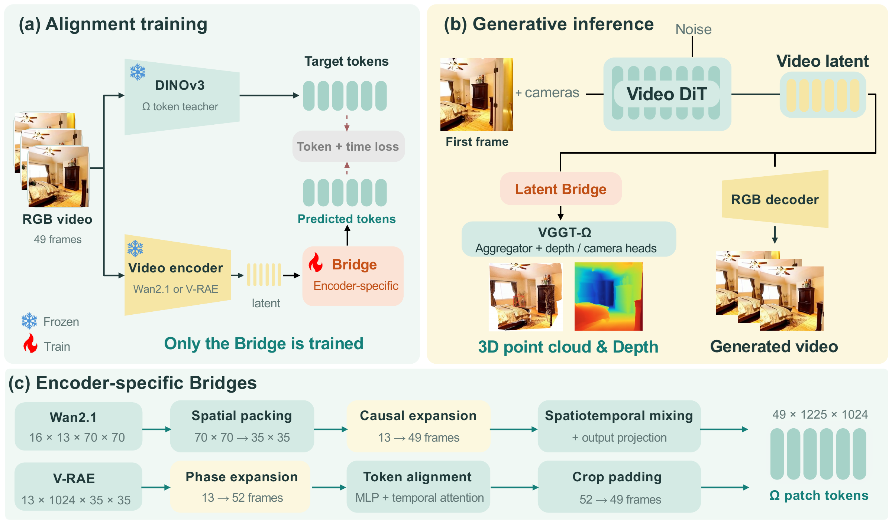

<h1 align="center">Latent Bridge: From Video Latents to 3D Geometry via Feature Alignment</h1>

<p align="center">
  Connecting video latent features to 3D geometry through feature alignment.
</p>

<p align="center">
  Shuai Zhang<sup>1</sup>&nbsp;&nbsp;
  Zhanpeng Ouyang<sup>2,‡</sup>&nbsp;&nbsp;
  Zhengqing Chen<sup>2</sup>&nbsp;&nbsp;
  Ruohong Mei<sup>2</sup>&nbsp;&nbsp;
  Shaoyu Chen<sup>2</sup><br>
  Weiqiang Ren<sup>2</sup>&nbsp;&nbsp;
  Hui Sun<sup>2</sup>&nbsp;&nbsp;
  Qian Zhang<sup>2</sup>&nbsp;&nbsp;
  Wenyu Liu<sup>1</sup>&nbsp;&nbsp;
  Xinggang Wang<sup>1,†</sup>
</p>

<p align="center">
  <sup>1</sup>Huazhong University of Science and Technology &nbsp;&nbsp; <sup>2</sup>Horizon Robotics
  <br>
  <sub>‡ Project leader &nbsp;·&nbsp; † Corresponding author</sub>
</p>

<p align="center">
  <a href="https://shuaizhang7.github.io/latent-bridge-page/"></a>
  <a href="https://arxiv.org/pdf/2610.28521"></a>
  
</p>

[中文](README.zh-CN.md) | [Data](docs/DATA.md) | [Evaluation](docs/EVALUATION.md)

## Introduction

Latent Bridge connects video generative latents to frozen geometric features through
feature alignment. It supports WAN and V-RAE latents and decodes full 49-frame
sequences into depth, camera poses and point clouds without an intermediate RGB
decoding step in the geometry path.

```text
WAN / V-RAE latents -> trainable Bridge -> frozen VGGT-Omega -> depth, cameras, point clouds
```



**Method overview.** Only the Bridge is trained to align video latents with frozen
Omega image features. At inference, the aligned tokens are decoded into depth,
cameras and point clouds; RGB video decoding is a separate branch. The bottom
panel shows the encoder-specific WAN and V-RAE Bridges.

Visit our [project page](https://shuaizhang7.github.io/latent-bridge-page/) for the
method overview, video comparisons and interactive 3D visualizations.

## Installation

Run from the repository root. Use Python 3.10+ and a GPU-compatible PyTorch 2.6+.
The commands below use Python 3.11 and PyTorch 2.9.1 with CUDA 12.8; choose another build
from the [official matrix](https://pytorch.org/get-started/previous-versions/) if your GPU/driver requires it.

```bash
python3.11 -m venv .venv
source .venv/bin/activate
python -m pip install --upgrade pip
python -m pip install torch==2.9.1 --index-url https://download.pytorch.org/whl/cu128
python -m pip install -e '.[prepare]'
python -m pip check
mkdir -p data weights runs
```

Geometry inference additionally requires an authorized VGGT-Omega installation and
`weights/omega.pt`: follow [backend setup](docs/DEPENDENCIES.md#installation).
Remove `--bf16` from commands if the GPU does not support BF16.

## Data Preparation

Put training videos in `data/raw/train`. Obtain the frozen encoder sources and
weights, then edit their paths in `configs/prepare_wan.json` or
`configs/prepare_vrae.json`; see [encoder setup](docs/PREPARATION.md#install-encoders).

```bash
python prepare_data.py --config configs/prepare_wan.json \
  --videos data/raw/train --output data/wan_train --device cuda --bf16

python prepare_data.py --config configs/prepare_vrae.json \
  --videos data/raw/train --output data/vrae_train --device cuda --bf16
```

Each video contributes its first 49 frames by default, square-center-cropped to
560x560. Split train/test sequences **before** preparing caches. Short/corrupt
videos fail; no synthetic frame repetition or silent skipping. To select other
windows use [a video manifest](docs/PREPARATION.md#explicit-windows).

Outputs are `pairs/*.pt`, provenance metadata, `train.jsonl` and `COMPLETE.json`.
Each pair contains `latent` and `teacher_tokens` without batch dimensions:

| Route | Training latent | Teacher tokens |
|---|---|---|
| WAN | `[16,13,70,70]`, native VAE scaling | `[49,1225,1024]` |
| V-RAE | `[13,1024,35,35]`, native features before diffusion normalization | `[49,1225,1024]` |

Teacher targets use the same 49 frames/crop. V-RAE alone prepends three reference
frames before encoding/pooling. A teacher cache alone needs about 117 MiB per
window at BF16 or 234 MiB at FP32. See [preparation details](docs/PREPARATION.md).

## Training

The following are example recipes, not exact historical training schedules.
Run one route at a time:

```bash
python train.py --config configs/wan.json --manifest data/wan_train/train.jsonl \
  --output runs/wan_train --steps 94000 --batch-size 1 --lr 2e-4 \
  --save-every 1000 --device cuda --bf16

python train.py --config configs/vrae.json --manifest data/vrae_train/train.jsonl \
  --output runs/vrae_train --steps 50000 --batch-size 1 --lr 5e-5 \
  --save-every 1000 --device cuda --bf16
```

For a quick check, use `--steps 2 --save-every 1` and a new output directory.
A successful run writes `step_*.pt` and `TRAINING_COMPLETE.json`.

Single machine, eight GPUs:

```bash
torchrun --standalone --nproc_per_node=8 train.py \
  --config configs/wan.json --manifest data/wan_train/train.jsonl \
  --output runs/wan_train_8gpu --steps 94000 --batch-size 1 --lr 2e-4 \
  --save-every 1000 --device cuda --bf16
```

For V-RAE replace the config, manifest, output, steps and LR with the V-RAE values
above. Batch size is per GPU; this example has global batch 8.
Only the Bridge trains. Output directories must be new; optimizer resume and
automatic validation/best-checkpoint selection are not implemented.

## Inference

Use your trained Bridge checkpoint and prepared native latent:

```bash
python infer.py --checkpoint runs/wan_train/step_094000.pt \
  --omega-checkpoint weights/omega.pt --latent data/wan_latent.pt \
  --output runs/wan_infer --device cuda --bf16 --export-ply
```

For V-RAE use `runs/vrae_train/step_050000.pt`, `data/vrae_latent.pt` and a new
output directory. Optional `--rgb-frames data/rgb_uint8.npy` adds point colors;
RGB must be uint8 `[49,560,560,3]` with matching frames/crop.

Outputs: `depth.npy`, `cameras.npz`, 49 full-density PLYs and `COMPLETE.json`.
Omit `--export-ply` if only depth/cameras are needed. All 49 frames decode together;
inference does not silently apply GT poses or depth filtering.

## Evaluation

Prepare an evaluation NPZ containing saved depth/cameras and matching GT using
[these instructions](docs/EVALUATION.md#prepare-an-evaluation-bundle), then run:

```bash
python evaluate.py --bundle data/wan_eval_case.npz --output runs/wan_eval \
  --filter log_mad_multiview --camera omega --sampling all --unit native
```

Use `--filter none` for the unfiltered baseline, with a new output directory.
V-RAE uses its own evaluation bundle. Filtering reuses saved depth, not generation.
Results are `metrics.json` and `prediction_mask.npz`; Accuracy, Completeness and
Chamfer are lower-is-better distances. Use `--unit meters` only for independently
calibrated GT. Report CO3D and WildRGB-D separately.

More arguments: `python train.py --help`, `python infer.py --help`,
`python evaluate.py --help`. Full protocol details are in [Evaluation](docs/EVALUATION.md).

## License

This project's code is released under the [Apache-2.0 license](LICENSE).
External models, weights and datasets remain subject to their own licenses and
terms; see [dependency details](docs/DEPENDENCIES.md).
